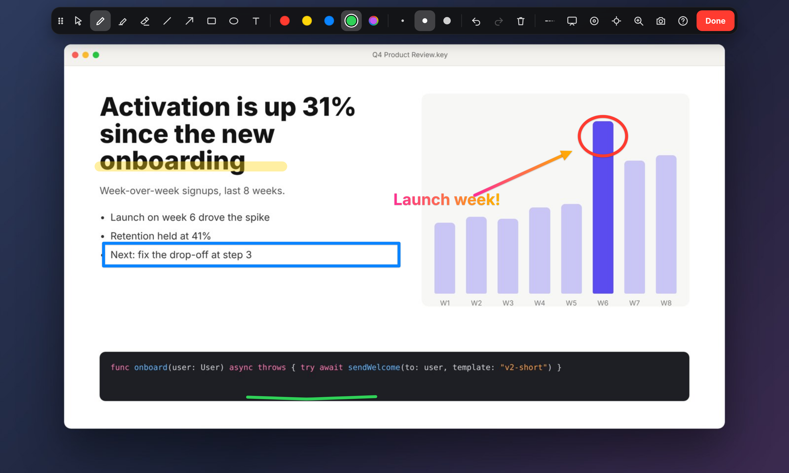
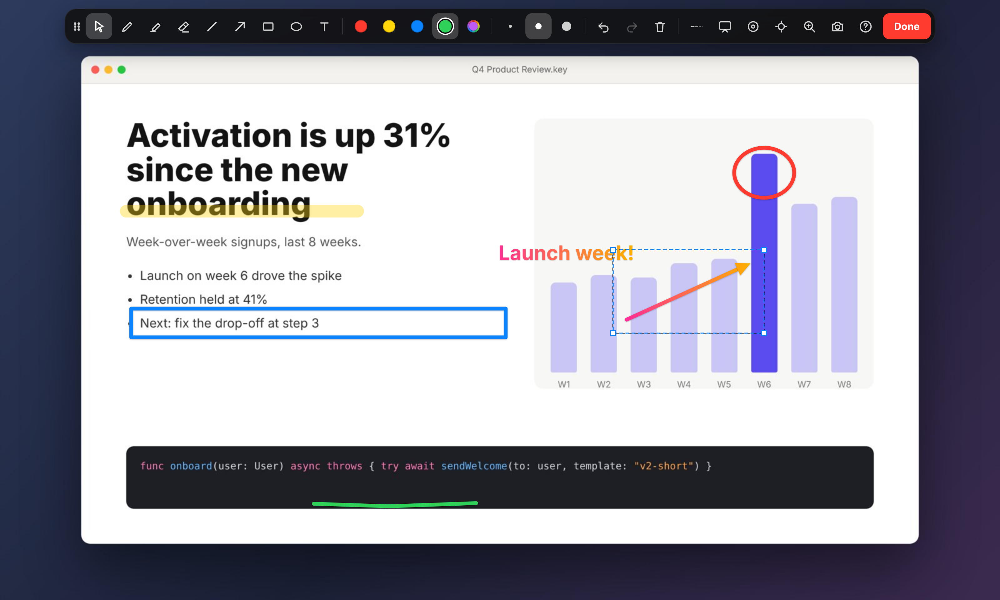
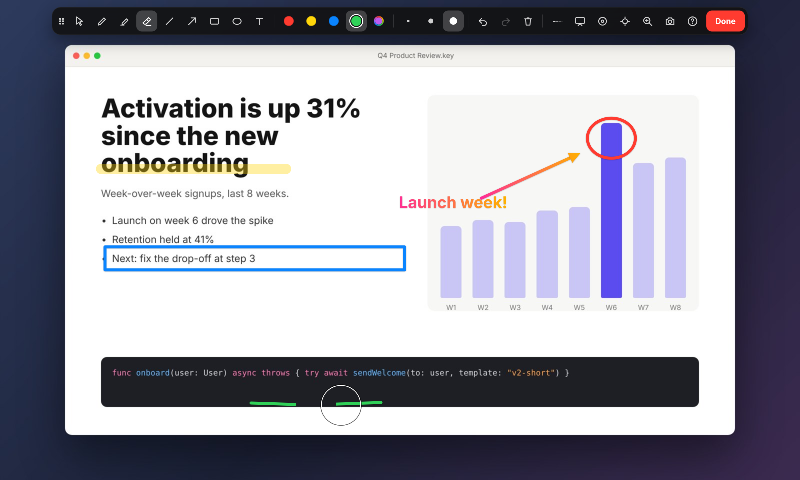
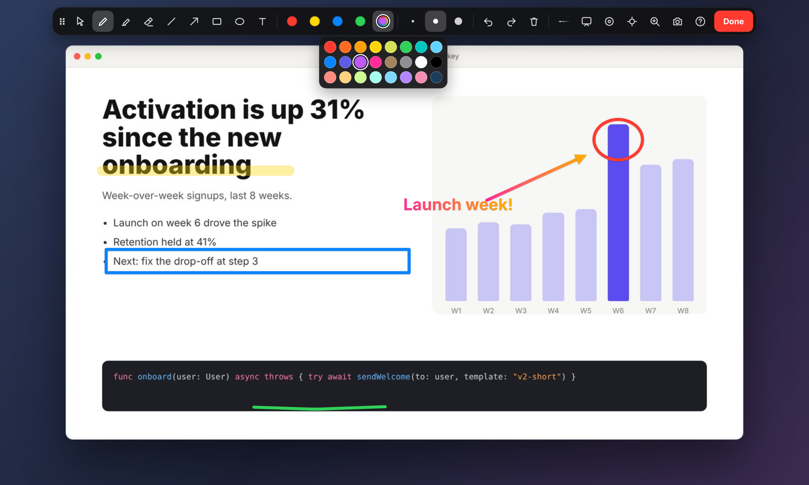
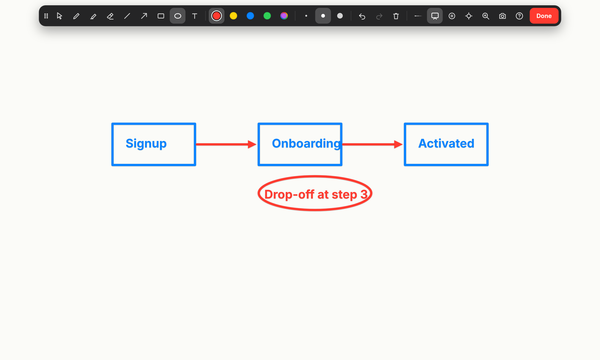
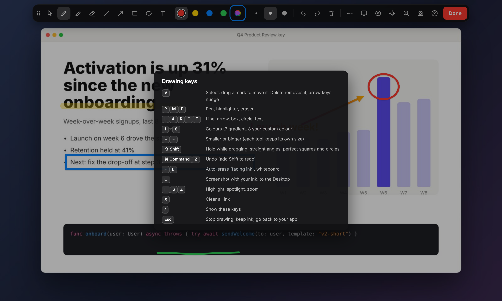
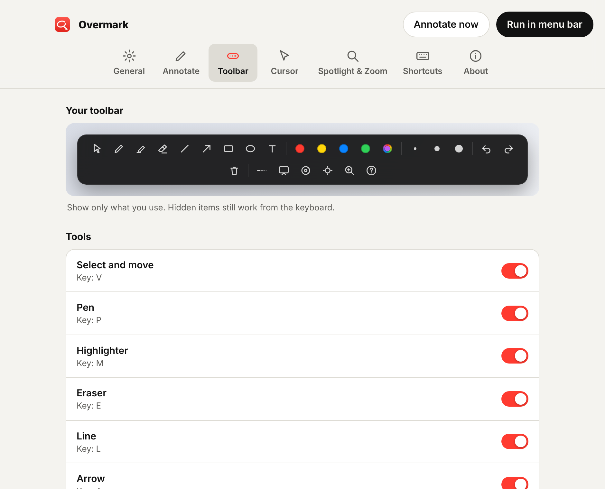
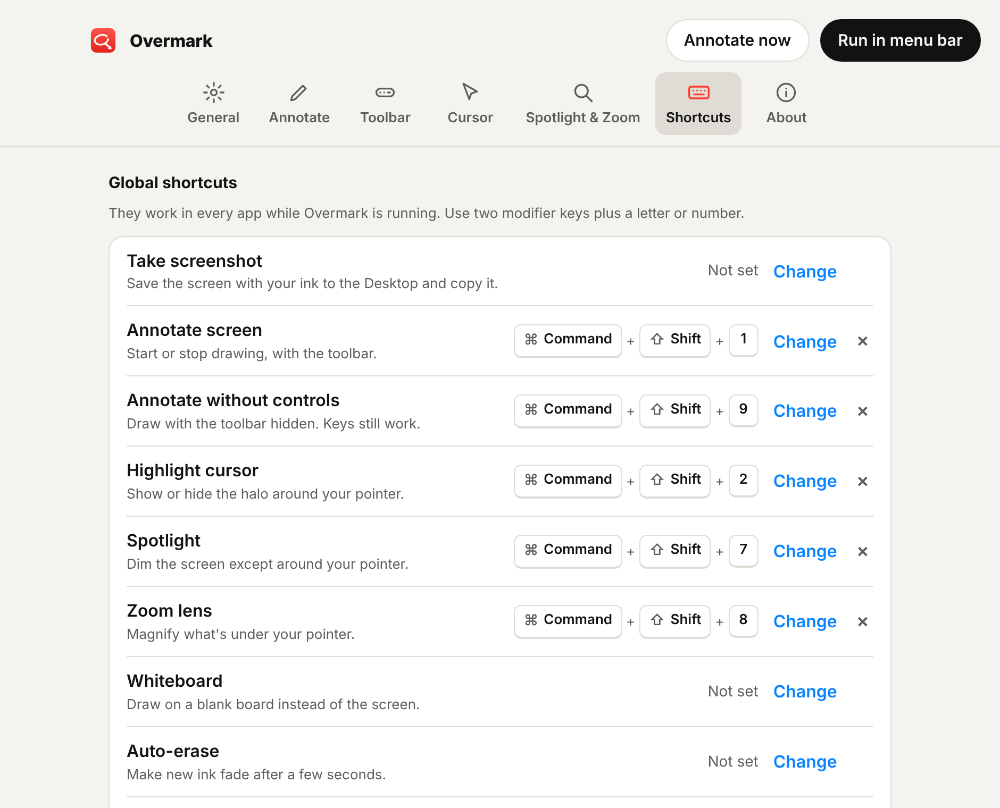

<p align="center"></p>
<h1 align="center">Overmark</h1>
<p align="center"><b>Draw on anything on your screen.</b><br>
Annotate, move, erase, highlight and spotlight your cursor, zoom and take screenshots, over any app on your Mac.<br>
Free and open source. Built with Claude by <a href="https://github.com/thepiyushway">@thepiyushway</a>.</p>

<p align="center">
  <a href="https://github.com/thepiyushway/overmark/releases"></a>
  <a href="https://github.com/thepiyushway/overmark/actions/workflows/tests.yml"></a>
  
  <a href="LICENSE"></a>
</p>

<p align="center"></p>

Overmark is a free alternative to paid screen-annotation apps such as Presentify ($14.99 on the Mac App Store) and Epic Pen. Press **⌘⇧1** in any app and draw: circle the number that matters, point an arrow at the bug, highlight the line you're explaining. Press **Esc**, and your ink stays on screen while you carry on working.

It started as an experiment to see whether a **Claude app**, built and installed from Claude, could replace a paid utility. The same single `index.html` now also ships as a normal downloadable Mac app that anyone can use, with no Claude account needed.

## Download

**[⬇ Download the latest release](https://github.com/thepiyushway/overmark/releases)**: `Overmark-<version>-arm64.dmg` for Apple Silicon (M1 and later), or `-x64.dmg` for Intel.

Open the DMG, drag Overmark to Applications, and open it. Until releases are notarized by Apple, macOS asks you once to allow it: System Settings → Privacy & Security → **Open Anyway**. Step-by-step instructions are in [docs/SETUP.md](docs/SETUP.md).

Overmark updates itself. When a new version is out, you'll see it in a notification, in Settings and on screen, and you install it from the menu bar.

## What it does

### Draw, erase, write
| | |
|---|---|
|  | **Select and move (V):** click any arrow, box, circle, text or stroke and drag it somewhere else. Arrow keys nudge it, and Delete removes just that mark. Everything you do can be undone, step by step. |
|  | **Pen, highlighter, eraser, line, arrow, box, circle and text.** Hold Shift for straight 45° lines and perfect squares and circles.<br><br>**Eraser (E):** rub out just part of your ink in three sizes. A ring shows what it will remove.<br><br>Undo and redo with ⌘Z and ⇧⌘Z. Undo even brings back ink you cleared by mistake.<br><br>**Each tool keeps its own size**, and a stylus draws thicker when you press harder. |
|  | **Colours:** red, yellow, blue and green on the toolbar, plus a **colour picker** with 24 quick colours. Any shade, gradient ink, orange and white are available from Settings and by key.<br><br>**Auto-erase (F)** fades ink after 1–15 seconds, so you can keep presenting. **Screenshot (C)** saves the screen with your ink to the Desktop and copies it. |

### Point at things
  

- **Highlight** your cursor: a circle, ring, squircle or rhombus, with colour, opacity, size, border, glow and pulse.
- **Spotlight:** dim everything except around the pointer.
- **Zoom lens:** magnify what's under the pointer, 1.5–5×.

### Explain on a blank page
 

**Whiteboard (B):** a white, dotted or dark board with its own ink, separate from your screen ink. **/** shows every key while you draw.

### Make it yours
 

- **Toolbar:** show only what you use. Every tool, colour, size and button can be switched on or off, with a live preview, and hidden items still work from the keyboard.
- **Shortcuts:** change any global shortcut. They work with Stream Deck's Hotkey action.
- **Settings** has live previews for the cursor effects, and everything is saved.

## Shortcuts
| Anywhere | |
|---|---|
| ⌘⇧1 | Start or stop drawing |
| ⌘⇧9 | Draw with the toolbar hidden |
| ⌘⇧2 · ⌘⇧7 · ⌘⇧8 | Highlight cursor · Spotlight · Zoom |
| ⌘⇧0 | Clear all ink |
| (set your own) | Whiteboard, auto-erase, screenshot |

**While drawing:**
- **V** select and move (arrows nudge, Delete removes) · **P M E** pen, highlighter, eraser · **L A R O T** line, arrow, box, circle, text
- **1–8** colours (5 orange, 6 white, 7 gradient, 8 custom) · **− =** smaller or bigger
- **⌘Z / ⇧⌘Z** undo and redo · **F** auto-erase · **B** whiteboard · **C** screenshot · **H S Z** highlight, spotlight, zoom · **X** clear
- **/** shows every key · **Esc** finishes and hands the mouse back to your app

## Two editions, one codebase
| | **Mac app (download)** | **Claude app** |
|---|---|---|
| Who it's for | Anyone | People using the Claude desktop app |
| Install | DMG from [Releases](https://github.com/thepiyushway/overmark/releases) | Open the Overmark artifact in Claude → **Install as Mac app** |
| Needs | macOS 12+. Works offline, no account | Claude desktop app, signed in |
| Updates | Built-in updater, with checksum and signature checks | Automatic when the artifact is republished |
| Zoom and screenshots | Allow **Overmark** under Screen Recording | Allow **Overmark** and **Claude** under Screen Recording |

## Build it yourself
```bash
git clone https://github.com/thepiyushway/overmark.git
cd overmark/desktop
npm install
npm start         # run it
npm test          # end-to-end tests of the real app (user flow + every feature)
npm run dist      # → desktop/dist/Overmark-<version>-arm64.dmg and -x64.dmg
```

## Quality
Every push runs **138 automated end-to-end checks against the real app**: a 33-step user flow and a 105-step test of every feature. A web smoke test runs too. Releases are built and checked on macOS before they're published. Results, and the bugs the tests caught, are in **[docs/TESTING.md](docs/TESTING.md)**.

`main` is where work happens; pushing to `release` ships an update to everyone ([docs/RELEASING.md](docs/RELEASING.md)). Signing and notarization are ready to switch on ([docs/SIGNING.md](docs/SIGNING.md)). Design notes are in [docs/ARCHITECTURE.md](docs/ARCHITECTURE.md).

## Privacy
Overmark sends nothing anywhere and needs no account. It reads your pointer position only while a cursor effect is on. Zoom and screenshots use macOS's own `screencapture`: zoom copies a small square around the pointer to a temporary file, and screenshots go to your Desktop. The Claude-app edition keeps a small private diagnostics log (state and events, never what you draw) in its artifact database. The downloadable app keeps none.

## Credits
Built by [@thepiyushway](https://github.com/thepiyushway) with Claude. Font: Schibsted Grotesk (SIL Open Font Licence). [MIT licence](LICENSE).
