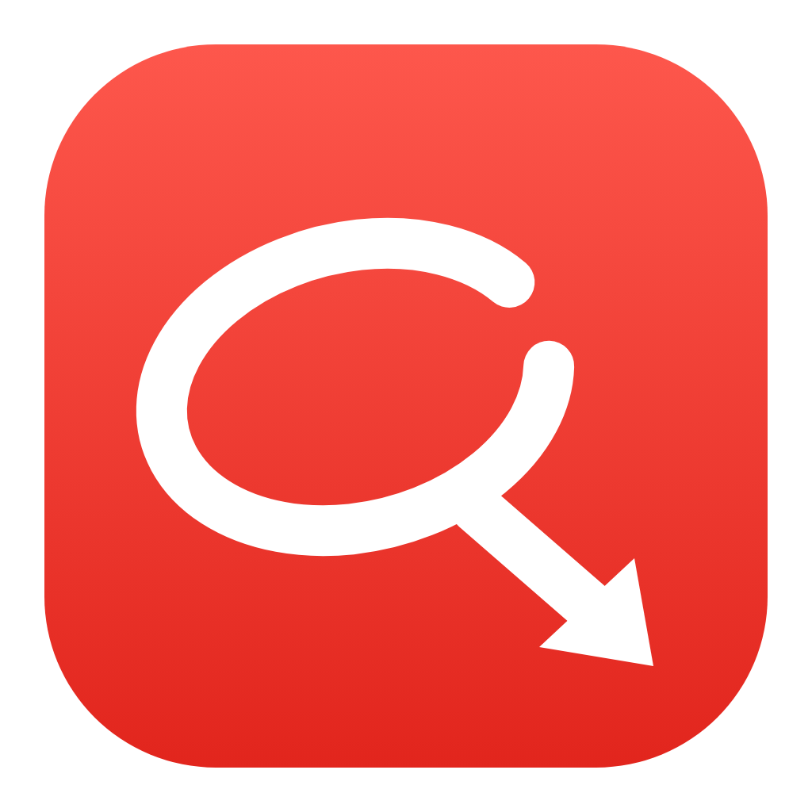
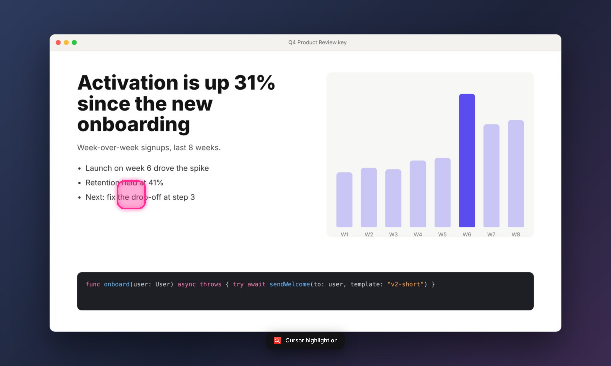
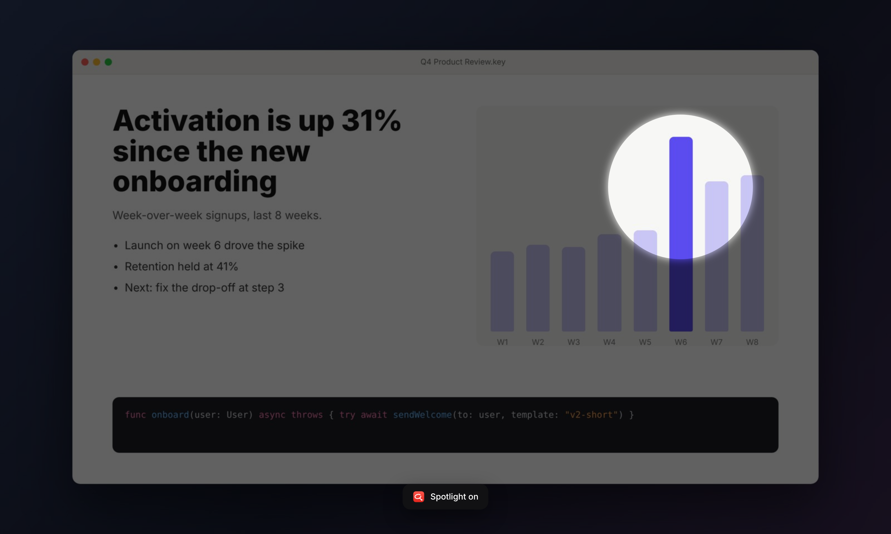
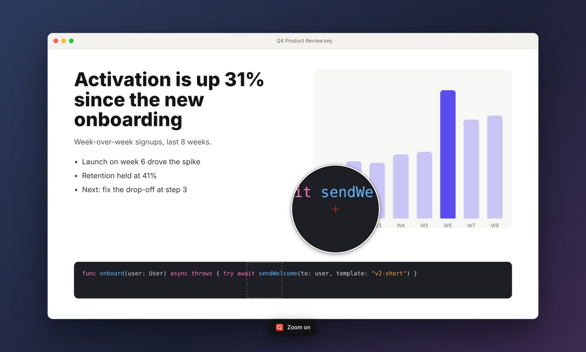
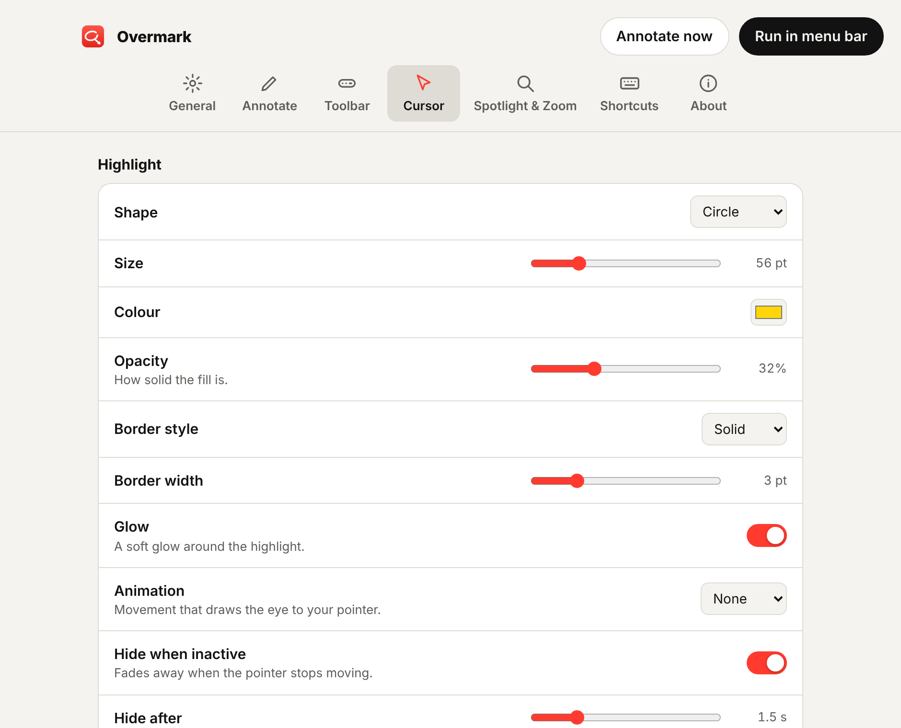

<p align="center"></p>
<h1 align="center">Overmark</h1>
<p align="center"><b>Draw on anything on your screen.</b> Annotate, highlight and spotlight your cursor, and zoom, over any app on your Mac.<br>
Free and open source. Built with Claude by <a href="https://github.com/thepiyushway">@thepiyushway</a>.</p>

<p align="center"></p>

Overmark is a free, open-source alternative to paid screen-annotation apps such as Presentify ($14.99 on the Mac App Store). It started as an experiment: can a **Claude app**, an artifact installed from Claude as a Mac app, replace a paid utility? It can. The same single `index.html` also ships as a standalone Mac app.

## Two ways to run it

| | **Claude app** | **Standalone Mac app (DMG)** |
|---|---|---|
| Install | Open the shared Overmark artifact in the Claude desktop app → **Install as Mac app** | **[Download the DMG](https://github.com/thepiyushway/overmark/releases)**, or build it yourself (below) |
| Needs | Claude desktop app, signed in | macOS 12+ |
| Zoom lens | Yes, for your own Claude organization (it needs Claude's full-access permission) | Yes |
| Menu bar only, no Dock icon | Dock icon stays while it runs | Yes |
| Updates | Automatic when the Claude app is republished | Built-in updater: notifies you and installs from the menu bar |
| Needs Claude? | Yes | **No**: works for anyone, offline, no account |
| Diagnostics | Writes a private log to the artifact's database, readable by you and Claude | Off |

## Features

### Draw over anything
Pen, highlighter, line, arrow, box, circle and text. Six colours you can change, plus **gradient ink**. Hold **Shift** for straight 45° lines and perfect squares and circles. Undo and redo. **Auto-erase** makes ink fade 1–15 s after you draw it. **Annotate without controls** hides the toolbar. Press **/** for an on-screen key sheet. **Esc** keeps your ink and hands the mouse and keyboard back to your apps (interactive mode).

 

**Whiteboard:** switch to a blank white, dotted or dark board with its own ink, and come back to your screen ink untouched.

### Cursor highlight, spotlight and zoom
  

- **Highlight:** circle, ring, squircle or rhombus. Choose the colour, opacity, size, border (solid, dashed, dotted or none), glow, and a pulse or breathe animation. It can hide itself when the pointer stops.
- **Spotlight:** dims everything except around the pointer. Circle, rounded rectangle or squircle, with size, dim strength and a soft edge.
- **Zoom lens:** follows the pointer and sits just beside it so it never magnifies itself. Magnification 1.5–5×, adjustable size and shape. It refreshes about 6–10 times a second using macOS's own `screencapture`.

### Settings, shortcuts and menu bar
 

Tabbed Settings (General, Annotate, Cursor, Spotlight & Zoom, Shortcuts, About) with live previews. Every action has a global shortcut you can change or clear, and they work with Stream Deck's Hotkey action. The menu bar menu has every mode.

| Default shortcut | Action |
|---|---|
| ⌘⇧1 | Annotate screen |
| ⌘⇧9 | Annotate without controls |
| ⌘⇧2 | Highlight cursor |
| ⌘⇧7 | Spotlight |
| ⌘⇧8 | Zoom lens |
| ⌘⇧0 | Clear all ink |
| (unset) | Whiteboard, auto-erase |

While drawing: **P M L A R O T** pick pen, highlighter, line, arrow, box, circle and text · **1–7** pick a colour (7 is gradient) · **− =** change width · **⌘Z / ⇧⌘Z** undo and redo · **E** auto-erase · **B** whiteboard · **H S Z** highlight, spotlight and zoom · **X** clear · **/** keys · **Esc** done.

**Not included:** click ripples. Neither a Claude app nor this standalone build listens to clicks in other apps, which would need Accessibility or Input Monitoring access.

## Install

See **[docs/SETUP.md](docs/SETUP.md)** for step-by-step setup, permissions and troubleshooting.

### Build the DMG yourself
On a Mac with Node 18+:
```bash
git clone https://github.com/thepiyushway/overmark.git
cd overmark/desktop
npm install
npm test            # 33-step end-to-end test of the app
npm run dist        # → desktop/dist/Overmark-<version>-arm64.dmg and -x64.dmg
```
With no Developer ID, builds are ad-hoc signed. The first time, open the app with right-click → **Open**, or go to System Settings → Privacy & Security → **Open Anyway**. To ship notarized builds, set `CSC_LINK`/`CSC_KEY_PASSWORD` and `APPLE_ID`/`APPLE_APP_SPECIFIC_PASSWORD`/`APPLE_TEAM_ID`; electron-builder then signs and notarizes.

Run without packaging: `npm start`.

## Updates (downloadable app)
Overmark checks GitHub Releases on launch and twice a day. When a new version is out you get a notification and **Install update** in the menu bar menu. It downloads the new version, checks it against the release's `SHA256SUMS.txt`, its code signature and its app ID, swaps it in and reopens. Check any time from the menu bar → **Check for updates…** or Settings → About. To publish one, see [docs/RELEASING.md](docs/RELEASING.md).

## How it works
One file, `index.html`, holds the whole app: the drawing engine, the overlay, settings and shortcuts. It talks to the operating system only through `claude.use("desktop")`:
- **As a Claude app**, Claude's desktop app provides that API: transparent always-on-top windows, global shortcuts, a menu bar item, and child processes for zoom.
- **As the standalone app**, [`desktop/preload.js`](desktop/preload.js) and [`desktop/main.js`](desktop/main.js) provide the same API with Electron.

Design notes and the bugs found along the way are in **[docs/ARCHITECTURE.md](docs/ARCHITECTURE.md)**. Every release must pass a 33-step end-to-end test of the real app and a web smoke test: results in **[docs/TESTING.md](docs/TESTING.md)**.

## Privacy
Overmark never reads what you type in other apps and sends nothing anywhere. It reads your pointer position only while a cursor effect is on. Zoom captures a small square around the pointer to a temporary file and shows it, then overwrites it. The Claude-app build writes a small diagnostics log (state and events, no content) to a private per-person record in its artifact database.

## License
[MIT](LICENSE) © 2026 thepiyushway
